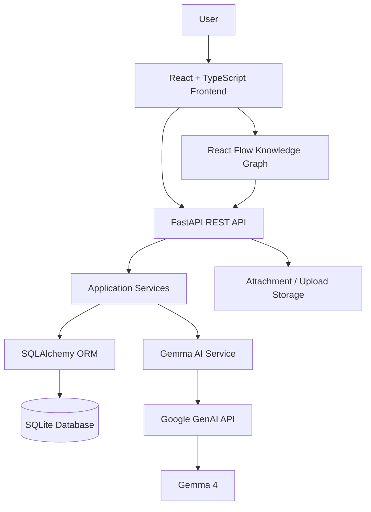

♜ Camelot — Temporal Intelligence Workspace

> **A project workspace that remembers not only what exists, but how it evolved.**
> Camelot is an AI-assisted temporal workspace for managing projects, ideas, decisions, questions, tasks, documents, relationships, and project history in one connected system.

## Instead of treating project information as disconnected pages, Camelot models it as a living knowledge graph with history — making it easier to understand what changed, why it changed, what is connected, and what should happen next.

🚀 Project Demo
Live Demo: Add your deployed URL here
GitHub Repository: `https://github.com/animespharikal-system/Camelot-Workspace`
Presentation / Pitch Deck: Add presentation link here
Demo Video: Add demo-video link here, if available

> For the hackathon submission, replace the placeholders above with the final deployed demo, presentation, and video links.

---

🎯 Problem & Opportunity
Modern software and research projects generate a large amount of information:
Ideas appear and disappear.
Decisions are made in meetings and chats.
Tasks move between people and statuses.
Documents become outdated.
New approaches replace old approaches.
Important context gets buried across different tools.
Teams remember what happened, but often lose track of why it happened.
Most project-management tools are optimized around the current state of a project.
The opportunity is to build a workspace that understands both:

> **Current state + project history + relationships + context**

## Camelot is designed around that idea.

💡 Our Solution
Camelot turns project information into a structured, connected and temporal workspace.
Users can create objects such as:
Projects
Ideas
Questions
Tasks
Decisions
Documents
These objects can be connected using relationships such as:
`CONTAINS`
`DEPENDS_ON`
`SUPPORTS`
`CONTRADICTS`
`REFERENCES`
`RELATED_TO`
`CREATED_BY`
`ASSIGNED_TO`
`SUPERSEDES`
`DERIVED_FROM`
The result is a project workspace where information is not isolated.
Example
Instead of storing:

> "We changed the architecture."
> Camelot can preserve a connected chain such as:

```text
Question
   ↓
Idea
   ↓
Decision
   ↓
Task
   ↓
Document
   ↓
New Decision
   ↓
Supersedes previous approach
```

## This creates a persistent project memory.

✨ The Wow Factor

1. 🧠 Temporal Project Memory
   Camelot is designed to preserve the evolution of a project instead of only storing its latest state.
   The goal is to make questions such as these answerable:
   What changed?
   When did it change?
   What led to the change?
   Which decision replaced the previous one?
   What work depends on this decision?
   What should we do next?

---

2. 🕸️ Project Knowledge Graph
   Every project can have its own visual knowledge graph.
   Objects become nodes and relationships become edges.
   The graph makes hidden dependencies and connections visible.
   Users can also create relationships directly through the graph interface.

---

3. 🤖 AI as a Reasoning Layer — Not the Source of Truth
   Camelot integrates Gemma 4 through Google's GenAI SDK.
   AI can help with:
   Context improvement
   Project-aware suggestions
   Contextual questions
   Summarization
   Identifying useful next actions
   Understanding relationships between project objects
   The important design principle is:
   > **AI suggests. The deterministic backend validates and the user remains in control.**
   > AI output is not allowed to silently become project state.

---

4. 🔄 Explainable Project Evolution
   A future-facing Camelot experience should be able to answer:
   > **"Explain how this project evolved."**
   > The system can combine:

```text
Objects
+
Relationships
+
Events
+
Timestamps
+
Decisions
=
Project Evolution
```

---

🧩 Core Features
Feature Description
Project Workspace Organize knowledge around individual projects
Knowledge Graph Visualize project objects and relationships
Temporal History Preserve project events and changes
Living Context Edit and maintain the context of project objects
Gemma AI Assistance Improve context and provide project-aware assistance
Object System Projects, ideas, questions, tasks, decisions and documents
Relationships Connect objects using explicit semantic relationships
Search Search across project information
Attachments Associate files with project objects
Team Members Represent project collaborators and roles
Project Isolation Keep knowledge graphs scoped to individual projects
FastAPI Backend Structured API layer for the workspace
SQLite Persistence Lightweight local development database
API Documentation FastAPI-generated interactive documentation

---

🛠️ Technology Stack
Technology Role Utilization
React Frontend framework Builds the interactive workspace UI
TypeScript Frontend language Type-safe frontend development
Vite Frontend tooling Development server and frontend build tooling
CSS UI styling Custom Camelot interface and workspace styling
React Flow / @xyflow/react Knowledge graph Visualizes nodes, relationships and project graphs
Lucide React UI icons Consistent interface icons
Python Backend language Server-side application logic
FastAPI Backend framework REST API and service layer
Pydantic Data validation Validates API requests and structured AI data
SQLAlchemy ORM Database models and persistence
SQLite Database Local project data persistence
Uvicorn ASGI server Runs the FastAPI backend
Google GenAI SDK AI integration Connects Camelot to Google's generative AI API
Gemma 4 AI model Context improvement and AI-assisted workspace intelligence
python-dotenv Configuration Loads environment variables from `.env`
Git Version control Tracks project history
GitHub Source collaboration Repository, collaboration and hackathon submission

---

🏗️ System Architecture



Architecture principle
Camelot separates AI reasoning from deterministic application state.

```text
User Input
    ↓
React Frontend
    ↓
FastAPI API
    ↓
Validation
    ↓
Deterministic Backend Logic
    ↓
Database

        ↘
          Gemma AI
          ↓
          Suggestion / Analysis
          ↓
          User Review
          ↓
          Explicit Save
```

## This prevents an AI model from directly controlling the database.

🔄 System Workflow

1. User creates a project

```text
User
 ↓
Creates Project
 ↓
Frontend sends request
 ↓
FastAPI validates request
 ↓
SQLAlchemy persists project
 ↓
Project appears in Camelot
```

---

2. User adds project knowledge
   The user can create:

```text
Idea
Question
Task
Decision
Document
```

Each object can contain:
Title
Context
Status
Project association
Metadata
Creation/update timestamps

---

3. User connects knowledge
   Objects can be connected through semantic relationships.
   Example:

```text
Project
  ├── CONTAINS → Idea
  ├── CONTAINS → Question
  ├── CONTAINS → Decision
  └── CONTAINS → Task

Idea
  └── SUPPORTS → Decision

Task
  └── DEPENDS_ON → Decision

Decision B
  └── SUPERSEDES → Decision A
```

---

4. Knowledge graph is generated
   The frontend retrieves project objects and relationships from the API.
   React Flow converts them into:

```text
Nodes = Project Objects
Edges = Relationships
```

## The user can explore the project visually and create links between objects.

5. Project history is recorded
   Important operations generate events.
   These events become part of the project's historical context.

```text
Object Created
       ↓
Object Updated
       ↓
Relationship Added
       ↓
Decision Changed
       ↓
New Context
```

---

6. Gemma assists the user
   When the user requests AI assistance:

```text
Current Context
      ↓
Camelot Backend
      ↓
Gemma 4
      ↓
AI Suggestion
      ↓
User Reviews
      ↓
Use / Dismiss
```

## The user remains responsible for accepting the result.

🧱 Project Structure

```text
Camelot-Workspace/
│
├── backend/
│   ├── app/
│   │   ├── routes/
│   │   │   ├── ai.py
│   │   │   ├── attachments.py
│   │   │   ├── events.py
│   │   │   ├── graph.py
│   │   │   ├── health.py
│   │   │   ├── members.py
│   │   │   ├── objects.py
│   │   │   ├── relationships.py
│   │   │   ├── search.py
│   │   │   ├── uploads.py
│   │   │   └── workspace.py
│   │   │
│   │   ├── services/
│   │   │   ├── events.py
│   │   │   ├── gemma_service.py
│   │   │   └── objects.py
│   │   │
│   │   ├── database.py
│   │   ├── graph.py
│   │   ├── main.py
│   │   ├── models.py
│   │   ├── schemas.py
│   │   └── seed.py
│   │
│   ├── tests/
│   ├── uploads/
│   ├── .env
│   ├── .env.example
│   ├── requirements.txt
│   └── test_gemma.py
│
├── frontend/
│   ├── src/
│   ├── index.html
│   ├── package.json
│   ├── tsconfig.json
│   └── vite.config.ts
│
├── README.md
├── .gitignore
├── run_backend.bat
├── run_frontend.bat
├── setup_camelot.bat
└── start_camelot.bat
```

> Do **not** commit `backend/.env`, virtual environments, local databases, `node_modules`, build output, or private API keys.

---

⚙️ Local Installation & Setup
Prerequisites
Make sure the following are installed:
Git
Python 3.10+
Node.js 18+
npm
A Google GenAI API key for Gemma-powered features
Check your installations:

```bash
git --version
python --version
node --version
npm --version
```

---

1. Clone the repository

```bash
git clone https://github.com/animespharikal-system/Camelot-Workspace.git
cd Camelot-Workspace
```

---

🐍 Backend Setup
Open a terminal inside the project root.

```bash
cd backend
```

Create a virtual environment:
Windows PowerShell

```powershell
python -m venv .venv
.venv\Scripts\Activate.ps1
```

macOS / Linux

```bash
python3 -m venv .venv
source .venv/bin/activate
```

Install dependencies:

```bash
pip install -r requirements.txt
```

---

Configure environment variables
Create:

```text
backend/.env
```

Add:

```env
DATABASE_URL=sqlite:///./camelot.db
GEMINI_API_KEY=YOUR_API_KEY_HERE
GEMINI_MODEL=gemma-4-26b-a4b-it
```

Important
Never commit the real API key.
The repository should contain:

```text
backend/.env.example
```

with:

```env
DATABASE_URL=sqlite:///./camelot.db
GEMINI_API_KEY=
GEMINI_MODEL=gemma-4-26b-a4b-it
```

---

Start the backend
From `backend/`:

```bash
uvicorn app.main:app --reload
```

Backend:

```text
http://127.0.0.1:8000
```

Interactive API documentation:

```text
http://127.0.0.1:8000/docs
```

---

⚛️ Frontend Setup
Open a second terminal.
From the project root:

```bash
cd frontend
```

Install dependencies:

```bash
npm install
```

Start the development server:

```bash
npm run dev
```

The frontend will normally be available at:

```text
http://localhost:5173
```

---

🔌 API Surface
Camelot exposes REST endpoints for the main workspace entities.
Objects

```text
GET    /objects/
POST   /objects/
GET    /objects/{id}
PATCH  /objects/{id}
DELETE /objects/{id}
```

Relationships

```text
GET    /relationships/
POST   /relationships/
PATCH  /relationships/{id}
DELETE /relationships/{id}
```

Events

```text
GET    /events/
```

Members

```text
GET    /members/
POST   /members/
PATCH  /members/{id}
```

Graph

```text
GET    /graph/...
```

Search

```text
GET    /search/...
```

AI
Camelot also exposes AI-assisted endpoints for contextual workspace intelligence, including project/object-aware assistance.
See the generated FastAPI documentation at:

```text
http://127.0.0.1:8000/docs
```

## for the exact request and response schemas.

🤖 Gemma Integration
Gemma is integrated through the Google GenAI Python SDK.
The backend keeps AI interaction inside:

```text
backend/app/services/gemma_service.py
```

The frontend communicates with the backend instead of exposing the API key.
AI request flow

```text
React
  ↓
FastAPI
  ↓
Gemma Service
  ↓
Google GenAI API
  ↓
Gemma 4
  ↓
FastAPI
  ↓
React
```

## This keeps the API credential server-side.

🔐 Security & Data Principles
Camelot follows several important principles:
API keys stay server-side
The frontend does not contain the Gemini API key.
Environment variables
Secrets are loaded through `.env`.
AI does not directly mutate the database
AI output should be treated as a proposal or suggestion.
Validation before persistence
Pydantic schemas validate API input before data is persisted.
Explicit user control
The user decides whether an AI-generated suggestion should become part of the project context.

---

🧠 Data Model
Camelot uses a graph-oriented project model.
Objects

```text
Project
Idea
Question
Task
Decision
Document
```

Each object contains information such as:

```text
id
type
title
content
status
project_id
metadata
created_at
updated_at
```

Relationships

```text
source_id
target_id
type
weight
created_at
```

## This allows Camelot to represent semantic connections rather than only folder hierarchies.

📜 Temporal Intelligence
A core design goal is preserving project evolution.
For example:

```text
Day 1
↓
Idea created

Day 2
↓
Question raised

Day 3
↓
Decision made

Day 5
↓
Implementation started

Day 8
↓
Decision changed

Day 9
↓
New decision supersedes old decision
```

Instead of deleting the old context, Camelot can preserve the relationship between the old and new state.
This makes historical reasoning possible.

---

🧪 Challenges We Faced
Building Camelot involved several engineering challenges.

1. Modeling project information as a graph
   Traditional CRUD applications are straightforward.
   Camelot needed to represent:

```text
Objects
+
Relationships
+
Projects
+
Events
+
History
```

## without losing the simplicity of a normal application.

2. Project-scoped graph isolation
   A large global graph quickly becomes difficult to understand.
   We therefore designed the workspace around project-level knowledge graphs, so each project can have its own connected knowledge space.

---

3. Connecting AI without giving AI control
   One of the biggest design challenges was deciding where AI should fit.
   We chose:

```text
AI = Reasoning / Suggestion Layer
Backend = Source of Truth
User = Final Decision Maker
```

## This makes AI assistance more transparent and safer.

4. Keeping AI output useful
   Generic AI responses are not enough for a project workspace.
   Camelot therefore sends relevant project/object context to the AI layer so that suggestions can be grounded in the workspace.

---

5. Preserving history
   A normal CRUD application often focuses on the latest state.
   Camelot needs to preserve enough historical context to explain project evolution.
   This influenced the object, relationship and event model.

---

📈 What's Next?
Camelot is designed to grow beyond the MVP.
Near-term
[ ] Better project timeline visualization
[ ] More contextual AI suggestions
[ ] Stronger structured AI responses
[ ] Improved search
[ ] Better attachment/document processing
[ ] More comprehensive automated tests
[ ] Production database support
Future
[ ] PostgreSQL production backend
[ ] Authentication and authorization
[ ] Real-time collaboration
[ ] Rich document understanding
[ ] Semantic / vector search
[ ] Automated project summaries
[ ] "Explain the evolution" mode
[ ] Change-impact analysis
[ ] AI-generated next-action planning
[ ] Conflict and contradiction detection
[ ] Multi-project intelligence
[ ] Cloud deployment
[ ] Advanced temporal queries

---

🌐 Cloud & Deployment Roadmap
The current development setup is optimized for local development.
The architecture is designed to move toward:

```text
Frontend
   ↓
Cloud Static Hosting
   ↓
FastAPI Backend
   ↓
PostgreSQL
   ↓
Object/File Storage

        ↘
       Google GenAI
       / Gemma
```

A production deployment can separate:
Frontend hosting
Backend compute
Database
File/object storage
AI services
This makes the system easier to scale without changing the core product model.

---

👥 Team
Camelot was built as a 3-person team.
Member Role GitHub
Animes Pharikal Full-Stack / AI / Product animespharikal-system
Team Member 2 Add role Add GitHub profile
Team Member 3 Add role Add GitHub profile

> Replace the two placeholders with the exact teammate names, roles and GitHub usernames before the final hackathon submission.
> GitHub collaboration
> All team members should be added to the repository as collaborators.
> Recommended workflow:

```text
main
 │
 ├── feature/frontend
 ├── feature/backend
 ├── feature/ai
 └── feature/graph
```

Create a feature branch:

```bash
git checkout -b feature/your-feature
```

Commit:

```bash
git add .
git commit -m "feat: add your feature"
```

Push:

```bash
git push -u origin feature/your-feature
```

## Then open a Pull Request into `main`.

🧑‍💻 Development Workflow
We recommend:

```text
Issue / Idea
    ↓
Feature Branch
    ↓
Implementation
    ↓
Local Testing
    ↓
Pull Request
    ↓
Code Review
    ↓
Merge to main
```

Use conventional commit prefixes where practical:

```text
feat:
fix:
docs:
refactor:
test:
chore:
```

Examples:

```bash
git commit -m "feat: add Gemma context polishing"
git commit -m "fix: isolate project knowledge graph"
git commit -m "docs: improve project README"
```

---

🧪 Testing
Backend tests are located in:

```text
backend/tests/
```

Run:

```bash
cd backend
pytest
```

For AI connectivity testing:

```bash
python test_gemma.py
```

## A successful Gemma test should return an AI-generated response.

📌 Hackathon Pitch
The problem
Projects accumulate knowledge, but that knowledge becomes fragmented and loses its history.
The solution
Camelot creates a connected workspace that combines:

> **Project Management + Knowledge Graph + Temporal Memory + AI Assistance**
> The differentiator
> Most tools help teams manage the present.
> Camelot is designed to help teams understand:
> **the present, the past, and the path between them.**
> The vision
> Build a workspace where a team can ask:
> **"What happened, why did it happen, what changed, and what should we do next?"**

## and receive an answer grounded in the project's own history and knowledge.

📄 License
Add the final project license here before public release.
Recommended:

```text
MIT License
```

---

🙌 Acknowledgements
Built for the hackathon with:
React
TypeScript
FastAPI
Python
SQLAlchemy
SQLite
React Flow
Google GenAI SDK
Gemma 4

---

⭐ If you find the idea interesting
Star the repository and follow the project's evolution.
Camelot — Temporal Intelligence Workspace

> _Don't just manage the project. Remember how it became what it is._
